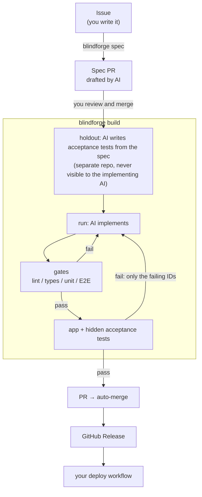
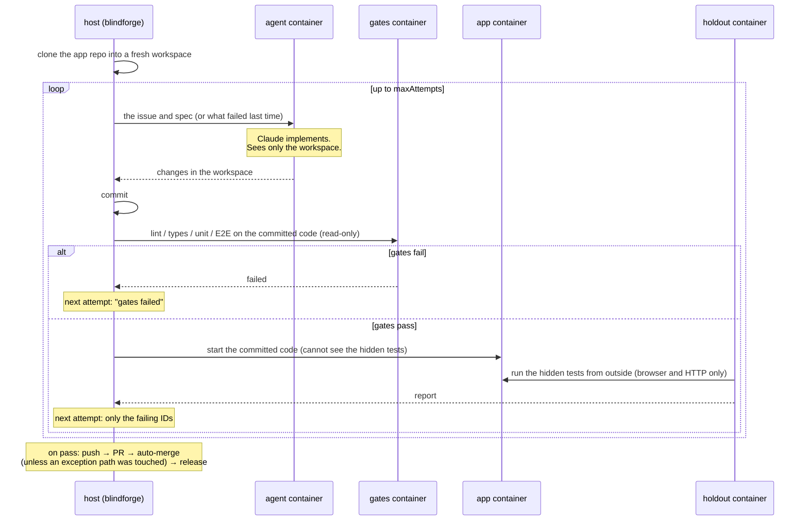

# blindforge

A software factory that runs on your own machine. **The AI implements features against acceptance tests it never gets to see.**

You write an issue and review a spec. blindforge has Claude draft the spec, write hidden acceptance tests (the *holdout*), and implement the feature in isolated Docker containers. The tests decide pass or fail, and on a pass blindforge merges the PR and cuts a release.



## Why "blind"?

If the AI that writes the code can read the tests that grade it, it can make those tests pass without doing the real work. blindforge keeps them apart:

- The acceptance tests live in a **separate repository** (`holdoutRepo`). They are mounted only into the `holdout` container, never into the container where the AI works.
- The tests drive the running app **from outside**, through a browser and HTTP only (Playwright).
- When tests fail, the AI gets back **only the IDs of the failing acceptance criteria**, never the test code.

## Requirements

- macOS or Linux with Docker (Docker Desktop on macOS)
- Node.js 22+
- [`gh`](https://cli.github.com/), logged in with access to your app repo and your holdout repo
- A Claude credential: `CLAUDE_CODE_OAUTH_TOKEN` (from `claude setup-token`) or `ANTHROPIC_API_KEY`
- Optional: [`sops`](https://github.com/getsops/sops) + [`age`](https://github.com/FiloSottile/age) + [`direnv`](https://direnv.net/) to keep the credential encrypted on disk

## What your app needs

blindforge expects a **Node.js web app on GitHub** that follows a few conventions:

| Convention | Why |
|---|---|
| Specs live in `specs/NNN-*.md` (other files in `specs/` are ignored), each with a `## Acceptance criteria` (or `## 受け入れ条件`) section holding tables of `\| ID \| what to check \|` rows (IDs look like `A12`) | Each ID becomes one hidden test |
| The app listens on `0.0.0.0:8787` when started with `appCommand` | Hidden tests reach it at `http://localhost:8787` |
| A health endpoint (`healthPath`) returns 2xx once the app is up | blindforge waits for it before testing |
| Production deploys run from a GitHub Actions workflow triggered by a `deploy-*` release | blindforge never holds production credentials |
| A separate, private repo for the hidden tests, created from [`templates/holdout`](templates/holdout) (a Playwright project with `tests/`, `scenarios/` and `scripts/summarize.mjs`) | Keeps the tests out of the implementing AI's view. `summarize.mjs` reduces results to IDs and pass/fail |

The containers come with Node, pnpm and Playwright. Apps that need other runtimes or services (Python, Go, a separate database, and so on) need changes to `agent.Dockerfile` and `compose.yaml`.

## Setup

### With Claude Code (recommended)

Open Claude Code in this directory and run the setup skill:

```sh
git clone https://github.com/junpayment/blindforge
cd blindforge
claude
> /blindforge-setup
```

It checks your machine, inspects your app repository, writes `apps/<app>.yaml`, creates the hidden-test repository from [`templates/holdout`](templates/holdout), and opens a PR on your app with what it needs (`specs/`, port 8787, a health endpoint, a deploy workflow, a bug form). It asks before creating or pushing anything.

### By hand

```sh
git clone https://github.com/junpayment/blindforge
cd blindforge
npm install

# 1. Configure your app (copy the sample and edit it; apps/* except the sample is gitignored)
cp apps/sample-app.yaml apps/my-app.yaml

# 2. Create a private repo for the hidden tests from templates/holdout,
#    and add what your app repo needs (see templates/app and "What your app needs")

# 3. Provide a Claude credential, either directly…
export CLAUDE_CODE_OAUTH_TOKEN=...      # or ANTHROPIC_API_KEY=...

#    …or encrypted with sops + age, loaded by direnv (.envrc is included)
sops --age "$(age-keygen -y ~/.config/sops/age/keys.txt)" secrets.enc.env   # CLAUDE_CODE_OAUTH_TOKEN=...
direnv allow                            # also puts bin/ on your PATH
```

Start Docker before running any command.

## Usage

```sh
# A new feature
blindforge spec  my-app <issue>   # AI drafts a spec PR. Review it and merge it.
blindforge build my-app <issue>   # hidden tests → implementation → auto-merge → release

# A bug inside an existing spec (put "spec: specs/002-auth-login.md" in the issue body)
blindforge build my-app <issue>   # skips the spec step and reuses that spec's tests

# After you merge a PR by hand (one that touched an exception path)
blindforge deploy my-app          # creates a deploy-YYYYMMDD-N release

# Watch
blindforge status                 # live TUI (--once to print once)
blindforge preview my-app <PR>    # run a PR in a container at http://127.0.0.1:8787
```

| Command | What it does | Who merges |
|---|---|---|
| `spec` | Drafts a spec from the issue. If the spec PR is already open, it applies your unaddressed review comments. | You |
| `holdout` | Writes a hidden test for every acceptance-criteria ID. Then checks that every ID has a test and that the tests run against the unimplemented app. The writer reviews why each test fails (or already passes) there, and fixes the tests that fail for the wrong reason. | Automatic |
| `run` | Implements the issue. It refuses to start unless every ID already has a hidden test. | Automatic. It stops for you on exception paths, zero tests, or after `maxAttempts` failures. |
| `build` | `holdout`, then `run` | |
| `regress` | Runs every hidden test against the base branch, outside of any build. Failures go into one issue on the app repo (IDs and spec numbers only) | — |
| `resume` | Continues from the issue's open draft PR: brings in the base branch (e.g. a corrected spec), updates the tests if the spec changed, re-scores the existing implementation, and keeps fixing | Same as `run` |
| `deploy` | Tags `main` and creates a GitHub Release | |

### Reviewing a spec

Leave comments on the spec PR (inline comments, review comments or plain comments) and run `blindforge spec` again. blindforge applies the comments, pushes to the same PR, and replies with what it changed.

### Acceptance criteria checked by gates

The hidden tests can only see the running app, so they can't check code-level rules such as "a unit test exists" or "lint passes". Put those criteria under a `###` heading containing the word `gate` (or ゲート), for example `### Code rules (checked by gates)`. Those IDs are left out of the hidden tests and handed to the implementing AI as things its gates (lint, typecheck, test, e2e) must satisfy.

### Acceptance-criteria IDs

Each ID names a hidden test, so IDs must be unique across the holdout repo. `spec` passes the AI the IDs already in use and warns on the PR when a draft reuses one.

## How it works



The AI never sees the hidden tests, their code, or their error messages. All it gets back is "gates failed" or the IDs of the acceptance criteria that failed.

### Isolation

| Container | Can see | Cannot see |
|---|---|---|
| `agent` | the workspace (read-write) and the Claude credential | hidden tests, GitHub credentials, your home directory |
| `gates` | the workspace (read-only) | hidden tests |
| `app` | the workspace (read-only) | hidden tests |
| `holdout` | hidden tests (read-only) and the report directory | the workspace |
| `holdout-writer` | the holdout clone and the app's `specs/` (read-only) | the app's source code |
| `judge` | the implementation, the hidden tests and the failing report, all read-only | nothing; but it only speaks in spec terms (below) |

- Only the host script pushes, opens PRs, merges and creates releases. The AI never touches GitHub.
- `gates` and `app` `git clone` the workspace, so only committed code gets tested. Nothing the AI leaves behind in its environment is carried over.
- After every AI commit, `.github/` is reset to its original state, so AI-written workflows can never read your deploy secrets.
- Changes to `exceptions` paths, and line deletions in `contractDeletionPaths`, wait for a human merge.
- This repository itself (compose file, orchestrator, exception lists) is never visible to the AI.

### The judge

A hidden test can be wrong too, and the implementing AI can't tell, because it only sees failing IDs. So when **the same IDs fail in two attempts in a row**, blindforge asks a judge, once per run. It also asks when acceptance tests failed and the next two attempts then failed the gates: the implementer may be bending the code toward a wrong test or spec and breaking an existing check. It's the only role that sees both the implementation and the tests, and it decides per ID against the spec:

| Verdict | What happens next |
|---|---|
| **test**: the spec is clear and the test doesn't check what it says | The test writer gets only how the test differs from the spec (never how the implementation behaves), fixes the tests, and the fix is merged into the holdout repo. The same implementation is re-scored without spending an attempt |
| **implementation**: the spec is clear and the code doesn't do it | The next fix prompt gets spec-grounded hints (never test code or errors) |
| **spec**: ambiguous, wrong, or contradicting another spec | The judge proposes a corrected spec as a PR for a human, and the implementation stops as a draft. After the spec PR is merged, `blindforge resume` brings it in, updates the tests for the changed rows, and continues |
| **unsure** | Stops as a draft with the judge's question for a human |

If a test fix breaks tests that passed before it, those go straight back to the test writer with their errors, since the implementer could never fix them.

The writer still never sees the implementation, and the implementer still never sees the tests.

### What a build runs

A build doesn't run all the hidden tests. It runs **this spec's tests plus the golden path**: tests tagged `@golden` (put `@golden` in the test title), a handful of core journeys such as signing in and the main flow. That keeps scoring fast, and an unrelated flaky test can't block the build. Set `holdoutScope: all` to run everything instead.

Breakage elsewhere is caught by `blindforge regress <app>`, which runs every test against the base branch. Run it after merges or on a schedule (cron, launchd, a CI job).

### Flaky tests

- **Lint and type-check**: the holdout repo's `npm run lint` (in [`templates/holdout`](templates/holdout)) runs ESLint rules that reject patterns that make tests flaky (fixed sleeps, reads that don't wait, `networkidle`, `force: true`), then `tsc --noEmit`, which catches mistakes such as calling a helper that only exists inside another test. The holdout agent has to pass it.
- **Repeat check**: after a build passes, this spec's tests run `repeatCheck` (3) more times without retries. A test that fails even once counts as failing, so the judge looks at it if it keeps happening. Racy code gets caught here too.
- **Ledger**: every test that passes only on retry, or fails when repeated, goes into `state/flaky.jsonl`. `blindforge status` lists the most frequent ones, and a test that's been flaky twice gets an issue in the holdout repo.

### Infrastructure failures

blindforge doesn't count network or Docker problems against the AI.

- Dependency installs run separately and exit with code `97` on failure.
- If an install fails, or the app never becomes healthy, blindforge retries once. If it fails again, it stops without using up an AI attempt and comments on the issue.
- Dependency caches live in named volumes and are reused between runs. The AI gets its own cache volume, separate from everyone else's.

### Deploys

blindforge never touches production. It tags `main` and creates a GitHub Release (`deploy-YYYYMMDD-N`). Your app's GitHub Actions workflow deploys on that release. The release is created with your `gh` token, so the workflow fires (releases created with `GITHUB_TOKEN` don't trigger workflows).

## Status TUI

```
blindforge status
```

- Runs: running, done, failed, error or interrupted, with the stage, attempt, elapsed time and PR
- Containers and traffic, per issue:

  ```
  [sample-app #135] build
    <#135 app>     --»-npm----->  <internet>  ↑200B/s ↓300kB/s
    <#135 holdout> -»--test-----> <#135 app>  localhost:8787
    <#135 holdout> ----npm----->  <internet>  idle
  ```

  - Each arrow points from the side that starts the connection to the side that answers. While data flows, `»` moves along the arrow, and the more data, the faster it moves.
  - Colors show roles: AI in magenta, tests in yellow, the app in green, gates in blue, outside hosts in gray.
  - Traffic comes from the growth of `docker stats` network counters. `holdout → app` traffic stays on the app's localhost, so it counts as flowing whenever `holdout` is up and `app` is healthy.
- Holdout progress while the acceptance tests run: the current phase (waiting for the app, installing test dependencies, running), a progress bar with passed / flaky / failed / skipped counts, elapsed time and an estimate of the time left, the tests running right now, and the ones that failed. The runs list shows a compact `holdout 34/120 ✗2`.

  ```
  Holdout progress
    #############----------------- 10/24 41%  1m01s elapsed, ~1m26s left
    ✓ 9  ~ 0 flaky  ✗ 1  - 0 skipped  ↻ 0 retried  4 workers
    running  D26 12s
    ✗ D25 header is gone on /history
  ```

  A small Playwright reporter (`reporter/progress-reporter.cjs`) is mounted read-only into the holdout container and writes test titles and outcomes to `reports/.../progress.jsonl` on the host. It records no test code and no error details, and the implementing AI never sees it.
- The events of the selected run, plus the AI's recent tool calls while it works

## App config (`apps/<app>.yaml`)

See [`apps/sample-app.yaml`](apps/sample-app.yaml).

| Key | Meaning |
|---|---|
| `repo` | App repository (`owner/name`) |
| `holdoutRepo` | Repository of the hidden acceptance tests |
| `baseBranch` | Branch to build from and merge into |
| `maxAttempts` | Implement/test rounds before giving up with a draft PR |
| `agent.maxTurns` | Turn limit for each Claude run |
| `installCommand` | Dependency install. On failure it exits 97, counted as an infrastructure failure. |
| `gatesCommand` | Lint, typecheck, tests and so on, run after the install |
| `appCommand` | Starts the app on port 8787, run after the install |
| `healthPath` | Path polled to decide that the app is up |
| `exceptions` | Paths that are never auto-merged. A trailing `/` means a directory. |
| `contractDeletionPaths` | Paths where deleting lines blocks auto-merge. Pure additions are fine. |
| `holdoutScope` | `targeted` (default): a build runs this spec's tests plus `@golden`. `all`: every test |
| `repeatCheck` | After a pass, run this spec's tests this many more times without retries (default 3, 0 = off) |
| `timeoutsMinutes` | Time limits for `agent`, `gates` and `holdout` |

## Limitations

- Issue dependencies (GitHub's "Blocked by") are not checked before a build.
- One issue per app runs at a time. Running issues in parallel isn't supported yet.
- Hidden tests are Playwright-only, so the app must be reachable over HTTP.

## License

[MIT](LICENSE)
